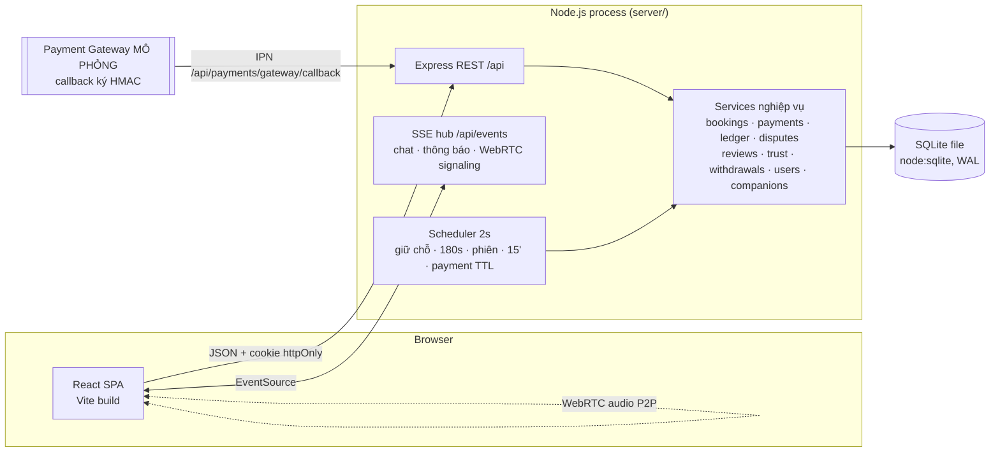

# Kiến trúc

## 1. Tổng quan – modular monolith



- **Một backend, một DB, một frontend.** Không microservice, không Redis/queue.
- Services chứa toàn bộ quy tắc nghiệp vụ; routes chỉ validate (Zod), phân quyền và gọi service.
- `ledger.js` là cửa duy nhất thay đổi số dư; `runFinancial()` bọc transaction + tạo cảnh báo đối soát khi ghi sổ lỗi.
- `clock.js`: mọi hạn chót dùng giờ server; test dùng đồng hồ cố định; demo có thể dịch giờ.
- `onCommit()`: đẩy realtime chỉ **sau** khi COMMIT ⇒ không bao giờ thông báo một thay đổi đã bị rollback.

## 2. Vì sao an toàn khi đồng thời

`node:sqlite` dùng API **đồng bộ** và mọi thao tác ghi bắt đầu bằng `BEGIN IMMEDIATE`; trong một tiến trình Node, một transaction chạy trọn vẹn trước khi request khác được xử lý ⇒ tuần tự hóa (serializable). Lớp bảo vệ thứ hai ở DB:
- `UPDATE slots SET status='HELD' … WHERE status='AVAILABLE'` phải ảnh hưởng **đúng N dòng**;
- `UNIQUE(companion_id, start_at)`, `UNIQUE(renter_id, request_key)`, `UNIQUE(ledger_transactions.reference)`, `UNIQUE(escrows.booking_id)`, `UNIQUE(disputes.booking_id)`, `UNIQUE(reviews.booking_id, reviewer_id)`;
- `transition()` cập nhật có điều kiện `WHERE status = <cũ>`.

Test `BK-04` bắn 20 request song song vào cùng slot → đúng 1 thành công. Nếu chuyển sang PostgreSQL (nhiều tiến trình), giữ nguyên các ràng buộc UNIQUE và dùng `SELECT … FOR UPDATE`/`SERIALIZABLE` cho các khối `tx()`.

## 3. Sequence – ghi sổ ký quỹ (Hình 1A b10–12)

```mermaid
sequenceDiagram
  participant R as Renter (SPA)
  participant A as API /bookings
  participant B as bookings.service
  participant L as ledger.service
  participant D as DB
  R->>A: POST /bookings {slot, hours, requestKey}
  A->>B: createBooking()
  B->>D: BEGIN IMMEDIATE; check request_key, slot, 10h; INSERT booking; UPDATE slots→HELD; COMMIT
  A->>B: escrowBooking()
  B->>D: BEGIN IMMEDIATE
  B->>B: kiểm tra lại held_until & số dư
  B->>L: postTransaction(ESCROW_HOLD:id, Nợ AVAILABLE / Có ESCROW)
  L->>D: INSERT txn + entries, UPDATE balances (không âm)
  B->>D: INSERT escrow HELD; slots→BOOKED; booking→PENDING_COMPANION (+180s); history
  alt mọi bước OK
    B->>D: COMMIT → push SSE cho Companion
  else lỗi bất kỳ
    B->>D: ROLLBACK (số dư nguyên vẹn) → ops_alert
  end
```

## 4. Sequence – callback cổng thanh toán (idempotent)

```mermaid
sequenceDiagram
  participant G as Gateway (mô phỏng)
  participant A as /payments/gateway/callback
  participant P as payments.service
  G->>A: {gatewayTxnId, status, amount, signature}
  A->>P: handleGatewayCallback
  P->>P: verify HMAC, amount; log payment_callbacks
  alt payment không còn PENDING
    P-->>G: DUPLICATE_IGNORED
  else SUCCESS
    P->>P: tx: post TOPUP:<id> (UNIQUE) ; payment→SUCCESS
    P->>P: nếu gắn đơn đang giữ chỗ → escrowBooking()
  else FAILED
    P->>P: payment→FAILED; đơn gắn kèm → CANCELLED (PAYMENT_FAILED)
  end
```

## 5. Sequence – khiếu nại (Hình 2C)

```mermaid
sequenceDiagram
  participant R as Renter
  participant S as disputes.service
  participant CS as CS Agent
  R->>S: báo sự cố (IN_SESSION / AWAITING_CONFIRMATION ≤ 15')
  S->>S: đã có khiếu nại? → trả hồ sơ cũ
  S->>S: tx: FREEZE (ESCROW→FROZEN), escrow FROZEN, dispute OPEN, booking DISPUTED, đính kèm chat log
  CS->>S: (tùy chọn) yêu cầu bổ sung → NEEDS_EVIDENCE; các bên gửi thêm → OPEN
  CS->>S: phán quyết {fault%, lý do}
  alt fault ≥ 80
    S->>S: tx: DISPUTE_REFUND + DISPUTE_PENALTY(20%, nợ nếu thiếu) → RESOLVED_REFUNDED
  else
    S->>S: tx: DISPUTE_RELEASE 88/12 → RESOLVED_RELEASED
  end
  S->>S: recalc TrustScore, audit (evidenceIds), thông báo hai bên
```

## 6. Scheduler

Mỗi 2 giây (và ngay khi khởi động để xử lý bù): hết giữ chỗ → `EXPIRED`; payment PENDING > 15' → `EXPIRED`; `PENDING_COMPANION` quá hạn → hoàn tiền + −3 điểm; `ACCEPTED` đến giờ → `IN_SESSION`; hết giờ → `AWAITING_CONFIRMATION`; quá 15' → giải ngân. Mỗi mục là một transaction riêng; lặp tối đa 4 vòng để xử lý chuỗi sự kiện khi đồng hồ demo nhảy xa. Scheduler **bỏ qua** đơn đang có cảnh báo đối soát mở cho cùng thao tác (chờ kiểm toán viên). Giới hạn: chạy trong cùng tiến trình – nếu tắt server, hạn chót được xử lý bù khi bật lại (người dùng không thao tác được trong lúc tắt nên không phát sinh mâu thuẫn).

## 7. Bảo mật

Mật khẩu scrypt + salt; phiên = token ngẫu nhiên 256-bit (lưu SHA-256) trong cookie `httpOnly; SameSite=Lax` (`Secure` ở production); chống CSRF bằng SameSite + bắt buộc `Content-Type: application/json` cho mọi request ghi; OAuth2 có `state`; truy vấn SQL tham số hóa; validate Zod; header `nosniff`, `X-Frame-Options: DENY`; AES-256-GCM cho eKYC và tệp bằng chứng (tên tệp được làm sạch, lưu tên ngẫu nhiên, trả về với CSP chặt); không có endpoint sửa số dư; công cụ demo bị cấm ở production (kiểm tra khi khởi động).

## 8. Chạy, migrate, seed, test
- DB: SQLite 3.51 (kèm Node 24). Migration: các tệp `server/src/migrations/*.sql`, áp dụng tự động theo bảng `schema_migrations`.
- Seed idempotent (`seedIfEmpty`) tạo dữ liệu **bằng chính các service nghiệp vụ** ⇒ sổ cái seed luôn cân bằng.
- Test: `node:test`, DB `:memory:`, server HTTP thật trên cổng ngẫu nhiên.
- Phương án chuyển PostgreSQL (nếu môn học bắt buộc): thay `db.js` bằng `pg` + `BEGIN ISOLATION LEVEL SERIALIZABLE`, chuyển SQL `INTEGER`→`BIGINT`; các service không đổi giao diện.
