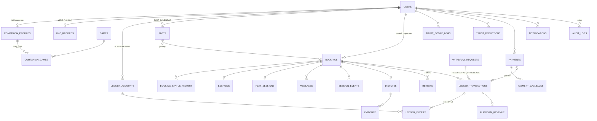

# Mô hình dữ liệu

Schema thật: [`server/src/migrations/001_init.sql`](../server/src/migrations/001_init.sql). Tiền = `INTEGER` VND; thời điểm = epoch ms (UTC).

| Bảng | Vai trò | Ràng buộc chính |
|---|---|---|
| users, auth_sessions | Tài khoản, vai trò, trạng thái eKYC, trust_score; phiên đăng nhập (hash token) | email UNIQUE |
| kyc_records | eKYC mock, họ tên/CCCD/ngày sinh **mã hóa AES-256-GCM**, lưu 4 số cuối | PK user_id |
| games, companion_profiles, companion_games | Danh mục game + rank; hồ sơ, giá, nhận booking, SUSPENDED; rank đã đối chiếu | |
| slots | SLOT_CALENDAR 1 giờ: AVAILABLE/HELD/BOOKED/UNAVAILABLE, held_until | UNIQUE(companion_id,start_at) |
| bookings | request_key, total_fee_snapshot, hourly_rate_snapshot, deadlines | UNIQUE(renter_id,request_key) |
| booking_status_history | Mỗi chuyển trạng thái + actor + lý do + bút toán | |
| ledger_accounts / ledger_transactions / ledger_entries | Sổ cái ghi kép, `balance_after` | reference UNIQUE; amount > 0; direction ∈ {DEBIT,CREDIT} |
| payments, payment_callbacks | Nạp tiền mock, log từng callback (chữ ký, kết quả) | UNIQUE(user_id,idempotency_key), gateway_txn_id UNIQUE |
| escrows | HELD/FROZEN/RELEASED/REFUNDED/SPLIT/FORFEITED | booking_id UNIQUE |
| platform_revenue | COMMISSION / LATE_CANCEL_FEE / DISPUTE_PENALTY | |
| play_sessions, session_events, messages | Phiên, log kết nối/gọi thoại/lọc tin, tin nhắn (flagged) | booking_id UNIQUE (session) |
| disputes, evidence | Khiếu nại + bằng chứng (TEXT/FILE/CHAT_LOG/SYSTEM, tệp mã hóa) | booking_id UNIQUE |
| reviews | 1–5★ hai chiều | UNIQUE(booking_id,reviewer_id) |
| trust_score_logs, trust_deductions | Log điểm cũ/mới/đầu vào; điểm trừ trực tiếp | UNIQUE(user_id,event_ref); ref UNIQUE |
| withdraw_requests | PENDING/PROCESSING/COMPLETED/REJECTED + payout_code | UNIQUE(user_id,idempotency_key) |
| notifications, ops_alerts, audit_logs, profile_views, settings | Thông báo in-app, cảnh báo đối soát, nhật ký kiểm toán, đo conversion, cấu hình runtime | |

**Mapping với ERD BT3:** `WALLET` (số dư khả dụng + ký quỹ) được hiện thực bằng các dòng `ledger_accounts` của user (AVAILABLE, ESCROW, FROZEN, WITHDRAW_HOLD, RECEIVABLE) – tránh lưu số dư trùng ở hai nơi. `SLOT_CALENDAR` = `slots`; `WITHDRAW_REQUEST` = `withdraw_requests`; `TRUST_SCORE_LOG` = `trust_score_logs`. Bổ sung so với ERD: `play_sessions`, `messages`, `session_events`, `disputes`, `evidence`, `ops_alerts`, `audit_logs` (cần cho UC04/UC05 và nhánh lỗi BPMN).
