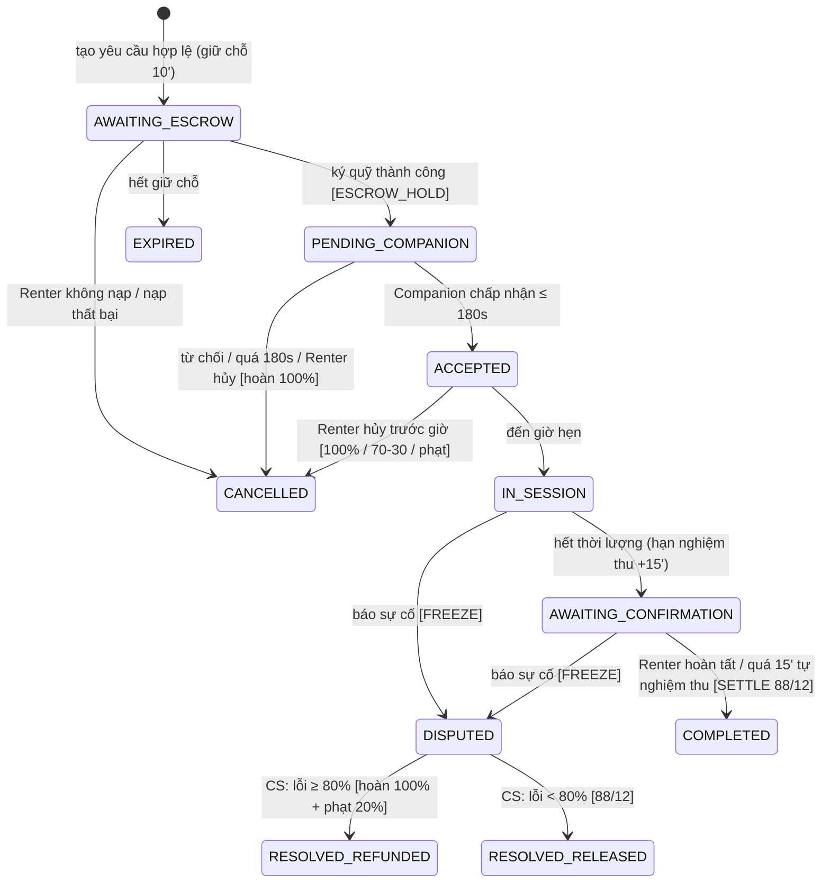

# Đặc tả yêu cầu & state machine

Ký hiệu nguồn: **[SRC]** = có trong tài liệu nguồn; **[INF]** = suy luận kỹ thuật cần thiết; **[DP]** = quy ước demo (xem DEMO_POLICY.md); **[DEF]** = để ngoài phạm vi.

## 1. Vai trò & phân quyền

| Hành động | Khách | Renter | Companion | CS | Admin |
|---|:-:|:-:|:-:|:-:|:-:|
| Xem/tìm Companion, xem hồ sơ | ✔ | ✔ | ✔ | ✔ | ✔ |
| Đặt lịch, ký quỹ, hủy, nghiệm thu, báo sự cố | | ✔ (đơn của mình) | | | |
| Chấp nhận/từ chối đơn | | | ✔ (đơn gửi tới mình) | | |
| Sửa hồ sơ, giá, lịch rảnh | | | ✔ (của mình) | | |
| Chat/gọi thoại trong phiên | | ✔ bên của đơn | ✔ bên của đơn | chỉ xem khi đơn có khiếu nại | như CS |
| Nạp tiền, xem ví/sổ giao dịch | | ✔ của mình | ✔ của mình | | xem tổng hợp |
| Rút tiền | | | ✔ (cần eKYC, không nợ phạt) | | |
| Đánh giá | | ✔ sau hoàn tất | ✔ sau hoàn tất | | |
| Gửi bằng chứng khiếu nại | | ✔ | ✔ | ✔ | ✔ |
| Yêu cầu bổ sung, phán quyết khiếu nại | | | | ✔ | ✔ |
| Duyệt rút tiền, cảnh báo đối soát, sổ cái, người dùng, audit, công cụ demo | | | | | ✔ |

Kiểm soát ở **server** (`requireRole`, kiểm tra chủ sở hữu từng đơn/hồ sơ/khiếu nại); ẩn nút ở UI chỉ là tiện ích. CS/Admin không xem được mật khẩu; CCCD chỉ hiện 4 số cuối.

## 2. Yêu cầu nguồn → hiện thực

| Mã | Nội dung tóm tắt | Hiện thực |
|---|---|---|
| BR-001 | Sàn an toàn, minh bạch, Escrow | Toàn bộ luồng Booking–Escrow–Ledger |
| BR-002 | 10.000 booking/3 tháng | [DEF] chỉ tiêu kinh doanh; dashboard đếm booking hoàn tất |
| BR-003 | Conversion ≥ 7,5% | Dashboard đo conversion [DP-11] |
| BR-004 | Xác thực, TrustScore/Rating, dispute dựa trên dữ liệu | eKYC (mock), rank qua Game API (mock), TrustScore, hồ sơ khiếu nại kèm log |
| FR-001 / UC01 | Đăng ký/đăng nhập, OAuth2, eKYC | Mật khẩu + OAuth2 mock + eKYC mock; luồng thay thế 3a/3b/5a và ngoại lệ (sai mật khẩu, eKYC thất bại, dịch vụ lỗi) |
| FR-002 / UC02 | Tìm, lọc, matchmaking, hồ sơ + xác thực | `GET /api/companions` (game, rank, giá, TrustScore, ngày, tên, sort); 2a tiêu chí một phần; 4a không có kết quả; ngoại lệ Game API |
| FR-003 / UR-004 | Profile, Slot Calendar, giá, nhận booking | Trang "Hồ sơ & Lịch" |
| FR-004 / UC03 / Hình 1A–1C | Booking request, khóa slot, state | Xem §3 |
| FR-005 | Wallet/Payment/Escrow/Ledger/Withdrawal | Xem FINANCIAL_RULES.md |
| FR-006 / UC04 | Chat real-time, WebRTC Voice, log | SSE chat + WebRTC P2P + `session_events`; 2a kết nối lại; 3a voice lỗi → dùng chat; ghi âm [DEF] |
| FR-007 / UC05 | Rating, TrustScore, Provider Verification, dashboard, dispute | Đầy đủ |
| NFR-001 | Tìm kiếm ≤ 2 giây | API trả `tookMs`; test AZ-05; dữ liệu demo ~vài ms |
| NFR-002 | Mã hóa AES-256, RBAC | AES-256-GCM cho eKYC & tệp bằng chứng; RBAC server |
| NFR-003 | Mở rộng ngang | [DEF] monolith; ghi rõ giới hạn |
| NFR-004 | Nhất quán, không ghi trùng, truy vết | Idempotency reference, transaction, đối soát, audit |
| NFR-005 | Luồng rõ ràng, trạng thái nhất quán | Stepper, đếm ngược theo giờ server, xem trước số tiền hoàn khi hủy, sổ cái theo đơn |
| NFR-006 | 99,9% | [DEF] |

**Khác biệt nguồn:** UC03 (Requirements) mô tả "Companion chấp nhận → rồi mới thanh toán", còn BPMN Hình 1A/1B (chi tiết hơn) là "ký quỹ trước → Companion trả lời trong 180 giây". Hệ thống theo **BPMN** (DL-03).

## 3. State machine

### Booking

Mọi chuyển khác bị cấm (`transition()` ném `INVALID_TRANSITION`). Mỗi chuyển ghi `booking_status_history` (từ, đến, người/hệ thống, lý do, bút toán). Cập nhật dùng điều kiện `WHERE status = <trạng thái cũ>` ⇒ hai thao tác đồng thời chỉ một thành công.

### Slot
`AVAILABLE → HELD (booking, held_until) → BOOKED` khi ký quỹ; `HELD/BOOKED → AVAILABLE` khi hủy/hết hạn (nếu còn ở tương lai, ngược lại `UNAVAILABLE`). UNIQUE(companion_id, start_at).

### Payment
`PENDING → SUCCESS` (cộng ví 1 lần) | `FAILED` | `EXPIRED` (quá 15'). Trạng thái cuối không đổi nữa; callback sau đó được ghi log `DUPLICATE_IGNORED`.

### Escrow
`HELD → RELEASED` (giải ngân) | `REFUNDED` | `SPLIT` (70/30) | `FORFEITED` (hủy muộn) | `FROZEN → REFUNDED / RELEASED` (khiếu nại). Chỉ module ví/ký quỹ đổi trạng thái Escrow, luôn cùng giao dịch sổ cái.

### Dispute
`OPEN ⇄ NEEDS_EVIDENCE` (CS yêu cầu; bên liên quan bổ sung → quay lại OPEN) `→ RESOLVED_REFUND | RESOLVED_RELEASE`. Một đơn tối đa một khiếu nại (UNIQUE booking_id).

### Session
`ACTIVE → ENDED` (hết giờ) | `INTERRUPTED` (báo sự cố khi đang chơi). UNIQUE(booking_id).

### Withdrawal
`PENDING → PROCESSING → COMPLETED`; `PENDING|PROCESSING → REJECTED` (bắt buộc lý do, trả tiền giữ).

### Review
Tạo một lần cho mỗi (booking, người đánh giá); chỉ khi đơn ở COMPLETED/RESOLVED_*; không sửa/xóa; không ảnh hưởng quyết toán tiền.

## 4. Nhánh lỗi được xử lý (đối chiếu BPMN)

| Tình huống | Kết quả |
|---|---|
| Gửi trùng yêu cầu (1A b2a) | Trả lại đơn cũ; cùng key khác nội dung → 409 |
| Slot vừa bị người khác chiếm (UC03 2a) | 409 `SLOT_UNAVAILABLE` |
| Vượt 10h/ngày | 422 `DAILY_LIMIT_EXCEEDED` |
| Thiếu số dư → không nạp (9a) / nạp lỗi (9b) / nạp xong vẫn thiếu (b8) | Hủy, không phát sinh ký quỹ / hết giữ chỗ tự nhả |
| Ghi sổ lỗi khi ký quỹ (b11) | Hoàn tác, đơn vẫn giữ chỗ, cảnh báo |
| Companion từ chối / quá 180s (1B) | Hoàn 100% trước, rồi mới hủy đơn; quá hạn −3 điểm |
| Ghi sổ lỗi khi hoàn (1B b5a, 1C b5a) | Giữ Escrow HELD + đơn nguyên trạng, cảnh báo, thử lại |
| Hủy sau giờ hẹn | Chặn, hướng dẫn báo sự cố |
| Ghi sổ lỗi khi giải ngân (2B b2a) | Giữ HELD, scheduler không tự thử lại, chờ kiểm toán viên |
| Khiếu nại trùng (2C b2a) | Trả hồ sơ cũ, không đóng băng lần 2 |
| Chưa đủ bằng chứng (6a/6b) | NEEDS_EVIDENCE, tiền vẫn đóng băng |
| Ghi sổ lỗi khi phán quyết (2C b9a) | Hồ sơ không đóng, tiền giữ nguyên, cảnh báo |
| Review trùng / người ngoài | 409 / 403 |
| Rút tiền vượt số dư / bị từ chối / xử lý 2 lần | 422 / trả tiền giữ / 409 |
